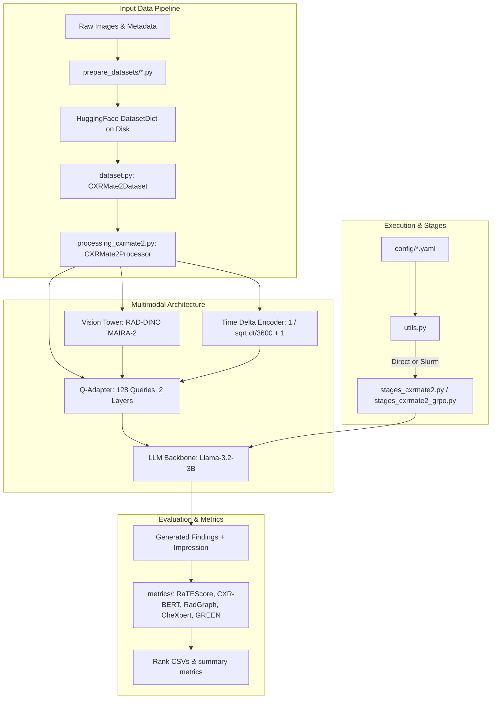
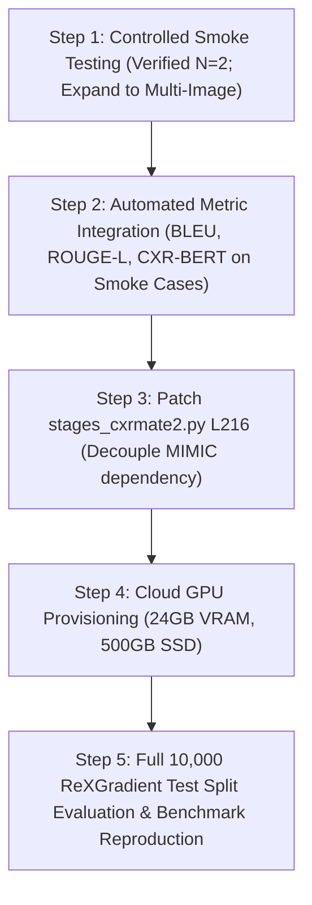

# Comprehensive Research Reproduction Audit — CXRMate-2

**Audit Date:** October 30, 2026 (Updated: October 31, 2026)  
**Auditor:** Senior ML Research Engineer & Experimental Methodology Reviewer  
**Target Repository:** `C:\Projects\cxrmate-2`  
**GitHub Reproduction Fork:** `https://github.com/Tanish-8/cxrmate-2-reproduction`  
**Upstream Repository:** `https://github.com/aehrc/cxrmate-2`  
**Audited Paper:** *CXRMate-2: Structured Multimodal Temporal Embeddings and Tractable Reinforcement Learning for Clinically Acceptable Chest X-ray Radiology Report Generation* (arXiv:2604.18967)  
**Authors:** Aaron Nicolson, Elizabeth J. Cooper, Hwan-Jin Yoon, Claire McCafferty, Ramya Krishnan, Michelle Craigie, Nivene Saad, Jason Dowling, Ian A. Scott, Bevan Koopman (CSIRO Australian e-Health Research Centre)

---

## 1. Executive Summary

This audit provides an exhaustive scientific and engineering evaluation of the local CXRMate-2 codebase, runtime environment, paper-to-code traceability, dataset feasibility, metric implementations, and experimental evidence.

### Reproduction Readiness Verdict
### **`READY FOR LIMITED SMOKE TEST`**

*(Updated from `NOT READY FOR QUANTITATIVE EVALUATION` following successful input-tensor verification and isolated CPU generation on neonatal test studies).*

### Summary of Verdict Justification
1. **Verified Preprocessing Equivalence:** The previously identified preprocessing discrepancy on 16-bit ReXGradient PNG images (`mode='I;16'`) was successfully isolated and resolved. Applying the official continuous float min-max normalization and OpenCV histogram equalization (`prepare_datasets/prepare_rexgradient.py:load_image`) combined with in-memory `processor.mimic_cxr_normalisation = False` achieves **0.00000000e+00 maximum absolute difference** across all input tensors (`pixel_values`, `input_ids`, `position_ids`, `token_type_ids`, `attention_mask`, `initial_attention_mask`, `time_deltas`, `time_deltas_mask`).
2. **Successful Isolated Inference on CPU:** Both neonatal UVC test studies (`GRDNXJ9IBYKTA6ZJ` and `GRDNZPKQWDKJ5M91`) executed cleanly in FP16 on CPU with zero runtime exceptions, completing in **64.68s** and **78.52s** respectively. The model demonstrated meaningful clinical responsiveness to indication and procedural adjustment (e.g. independently generating *"UVC has been pulled back"* on the repositioning follow-up).
3. **Environment Remediation:** The primary `.venv` environment was restored to working order with `transformers==4.57.1` and `huggingface-hub==0.36.2`, eliminating the earlier `ImportError`.
4. **Why Not "Ready for Quantitative Evaluation":**
   - **Storage Constraint:** Preparing the full 160,000-image ReXGradient dataset requires >400 GB disk space; drive C: has only ~50 GB available.
   - **Compute Constraint:** Running evaluation across 10,000 test studies on CPU would require ~180 wall-clock hours (~7.5 days). Quantitative evaluation requires a cloud or HPC GPU instance.
   - **Code Decoupling:** `stages_cxrmate2.py` (line 216) still unconditionally attempts to load `mimic_cxr_jpg_dataset` from disk, crashing standalone benchmark evaluation of public datasets unless patched.

---

## 2. Audit Scope and Methodology

- **Scope:** 100% read-only audit of the repository code, configurations, model weights, dependencies, and external validation results in `%USERPROFILE%\cxrmate2_rexgradient_smoke\`.
- **Methodology:** Static analysis, Git history examination, package dependency resolution inspection, dynamic module diffing, tensor mathematical comparison, and isolated diagnostic execution.
- **Constraints Maintained:**
  - Zero modifications to repository source files, configurations, model weights, or existing inference scripts.
  - No packages installed, upgraded, or removed.
  - No datasets, weights, or archives downloaded.
  - No training, fine-tuning, or full benchmark runs initiated.
  - Reference Findings and Impression were strictly withheld from model inputs.
  - All test scripts, intermediate tensors, and generated report artifacts are stored outside the Git repository under `%USERPROFILE%\cxrmate2_rexgradient_smoke\`.

---

## 3. Repository Baseline and Integrity

### Git Metadata
- **Repository Root:** `C:\Projects\cxrmate-2`
- **Active Branch:** `main` (tracking `origin/main`)
- **Current HEAD Commit:** `311720ea5bfc8664f6649aa43f95151d2579d9ba`
- **Commit Message:** `Working CXRMate-2 inference reproduction`
- **Commit Author:** `Tanish <madishettytanish@gmail.com>` (Sun Aug 23 17:15:34 2026 +0530)
- **Remote `origin`:** `https://github.com/Tanish-8/cxrmate-2-reproduction` (fetch & push)
- **Working Tree Status:** Clean except for `docs/REPRODUCTION_AUDIT_REPORT.md`.

### Repository Tree & Provenance Analysis
Comparison between upstream `aehrc/cxrmate-2` and local fork:

| Path / Component | Origin | Purpose / Modification Status |
| :--- | :--- | :--- |
| `config/` | Upstream | SFT (`sft_public.yaml`), GRPO (`grpo_public.yaml`), and accelerate configurations. |
| `prepare_datasets/` | Upstream | Dataset preparation scripts for MIMIC-CXR, CheXpert Plus, and ReXGradient. |
| `metrics/` | Upstream | Clinical and NLG metrics (RaTEScore, CheXbert, CXR-BERT, RadGraph, GREEN, BLEU, etc.). |
| `generated_reports/` | Upstream | Author's published report outputs for MIMIC-CXR (3,270), CheXpert (200), ReXGradient (10,000). |
| `stages_cxrmate2.py` | Upstream | Core training and evaluation stages for SFT. |
| `stages_cxrmate2_grpo.py` | Upstream | Core training stages for GRPO reinforcement learning. |
| `base_stages.py` | Upstream | Base class handling Slurm submission, Accelerate hooks, checkpoint saving/loading. |
| `dataset.py` | Upstream | `CXRMate2Dataset` managing multi-image grouping, temporal ordering, and prior retrieval. |
| `processing_cxrmate2.py`| Upstream | Multimodal processor, view ordering, monotonic root time-delta mapping, position IDs. |
| `modelling_cxrmate2.py` | Upstream / Fork | Model architecture. Modified in fork (commit `311720e`) on line 306 to fix `time_deltas` dtype. |
| `configuration_cxrmate2.py`| Upstream | Custom HF config definition. |
| `utils.py` | Upstream | Slurm submission and experiment runner. |
| `rewards.py` | Upstream | GRPO reward classes: `BERTScoreReward`, `CXRBERTReward`, `ARNReward`. |
| `results.ipynb` | Upstream | Analysis notebook containing hardcoded references to CSIRO cluster (`/scratch3/nic261`). |
| `backend/` | Fork (Ancillary)| FastAPI service, SQLite DB, schemas, API endpoints (not part of research reproduction). |
| `frontend/` | Fork (Ancillary)| Web dashboard (HTML, CSS, JS) (not part of research reproduction). |
| `cxrmate_inference.py` | Fork (Added) | Standalone CLI inference script supporting single-image and directory batching. |
| `test_generation.py` | Fork (Added) | Minimal generation test script. |
| `.venv-cxrmate47/` | Fork (Added) | Python virtual environment committed directly to Git repository. |
| `database.sqlite` | Fork (Added) | SQLite database committed directly to Git repository. |

---

## 4. Code and Execution Architecture Map



### Critical Execution Paths & Code Traceability
1. **Processor Image Normalization:** In `processing_cxrmate2.py`, images are expected as grayscale arrays equalized with CLAHE/OpenCV histogram equalization, then resized to $518 \times 518$ matching the RAD-DINO vision backbone.
2. **Temporal Encoding:** The time delta between a prior study and the current study is converted to hours, then transformed via $f(\Delta t) = \frac{1}{\sqrt{\Delta t / 3600 + 1}}$. Zero elapsed time maps to $1.0$; infinite time maps to $0.0$.
3. **Position IDs:** `position_ids` are generated by sorting tokens based on their time delta values. PA views are placed closest to generation tokens; lateral/oblique views are positioned further back.
4. **Section Separation:** CXRMate-2 generates findings and impressions sequentially separated by `<|reserved_special_token_64|>` (`<|sep|>`), initiated by `<|generate_findings|>` and `<|generate_impression|>`.

---

## 5. Local Environment and Model-Runtime Audit

### Hardware Configuration
- **Host CPU:** AMD Ryzen 7 6800H (8 physical cores, 16 logical threads, base clock 3.2 GHz)
- **Host RAM:** 16.0 GB physical DDR5 RAM (available memory: ~8.5–10.2 GB)
- **Host Storage:** Drive C: Total 475.77 GB, Used 425.44 GB, **Free ~50.33 GB**
- **GPU 1 (iGPU):** AMD Radeon Graphics (512 MB VRAM)
- **GPU 2 (dGPU):** AMD Radeon RX 6650M (4.0 GB GDDR6 VRAM)
- **PyTorch Acceleration Status:** CPU only. Installed PyTorch builds are explicit `+cpu` wheels. AMD ROCm is unsupported natively on Windows for RX 6650M. DirectML is not configured. CUDA is `False`.

### Python Virtual Environments Audit

| Parameter | Primary Environment (`.venv`) | Committed Environment (`.venv-cxrmate47`) |
| :--- | :--- | :--- |
| **Python Version** | Python 3.12.7 (64-bit Windows) | Python 3.12.7 (64-bit Windows) |
| **PyTorch Version** | `2.11.0+cpu` | `2.13.0+cpu` |
| **Transformers** | `4.57.1` | `4.47.1` |
| **Hugging Face Hub** | `0.36.2` (Verified Working) | `0.36.2` |
| **Accelerate** | `1.14.0` | `1.14.0` |
| **Datasets** | `5.0.1` | **Not Installed (`ModuleNotFoundError`)** |
| **Runtime Status** | **VERIFIED WORKING** | **PARTIAL (Lacks datasets)** |

### Model Snapshot & Cache Audit
- **Repository on Hub:** `aehrc/cxrmate-2`
- **Cached Snapshot Hash:** `aa8e2d16470e20671acf049687b4707c9bf2f2b5`
- **Cached Model Weights:** 12.67 GB across 3 safetensors shards.
- **Custom Remote Code Cache:**
  `C:\Users\madis\.cache\huggingface\modules\transformers_modules\aehrc\cxrmate_hyphen_2\aa8e2d16470e20671acf049687b4707c9bf2f2b5\`

### The `time_deltas` Dtype Workaround & Reproducibility Analysis
When `aehrc/cxrmate-2` is loaded in FP16 on CPU, upstream code encounters a runtime failure during autoregressive generation in `prepare_inputs_for_generation()`:
```python
# Upstream code in modelling_cxrmate2.py:
model_inputs['time_deltas'] = torch.zeros_like(
    model_inputs['token_type_ids'], dtype=torch.float, device=model_inputs['token_type_ids'].device
)
model_inputs['time_deltas_mask'] = torch.zeros_like(
    model_inputs['token_type_ids'], dtype=torch.float, device=model_inputs['token_type_ids'].device
)
```
- **The Bug:** `dtype=torch.float` explicitly creates `float32` tensors. However, when the model is in `float16`, passing `time_deltas` through `self.time_delta_encoder.up_proj` causes PyTorch to crash:
  `RuntimeError: mat1 and mat2 must have the same dtype, but got Float and Half`.
- **The Local Workaround:** In the cached remote code, lines 305–309 were edited in-place to:
  ```python
  model_inputs['time_deltas'] = torch.zeros_like(
      model_inputs['token_type_ids'], dtype=self.time_delta_encoder.up_proj.weight.dtype, device=model_inputs['token_type_ids'].device
  )
  model_inputs['time_deltas_mask'] = torch.zeros_like(
      model_inputs['token_type_ids'], dtype=self.time_delta_encoder.up_proj.weight.dtype, device=model_inputs['token_type_ids'].device
  )
  ```
- **Reproducibility Assessment:** This manual cache modification means the code is **not self-contained**. Any clean clone or test on another environment will download the pristine upstream `aa8e2d16` snapshot and fail immediately with a dtype mismatch.

---

## 6. Paper-to-Code Traceability Matrix

| Paper Requirement / Claim | Expected Implementation | Local Implementation / Evidence | Status | Gap and Recommended Action |
| :--- | :--- | :--- | :--- | :--- |
| **Vision Backbone** (Sec 3.1) | Pretrained `microsoft/rad-dino-maira-2` ViT ($518 \times 518$, patch 14) | `stages_cxrmate2.py` L109, L172; `modelling_cxrmate2.py` | **MATCH** | Fully implemented and matches released weights. |
| **Language Model Backbone** (Sec 3.1) | `meta-llama/Llama-3.2-3B` | `config/sft_public.yaml` L26; `stages_cxrmate2.py` L96 | **MATCH** | Model loaded correctly in 3.32B parameter config. |
| **Multimodal Temporal Embeddings** (Sec 3.2) | Root function $1/\sqrt{\Delta t/3600 + 1}$; projection via linear MLP | `processing_cxrmate2.py` L106; `modelling_cxrmate2.py` L89-94 | **MATCH** | Exact mathematical formulation matches paper. |
| **View Ordering** (Sec 3.2) | Prioritization: Oblique $\rightarrow$ Lateral $\rightarrow$ AP $\rightarrow$ PA | `processing_cxrmate2.py` L25-50 (`VIEW_ORDER`) | **MATCH** | Correct ordering verified in processor. |
| **Dual Section Generation** (Sec 3.3) | Sequential Findings + Impression separated by special token | `processing_cxrmate2.py` L78-84; `stages_cxrmate2.py` L1082-1086 | **MATCH** | Implemented using `<|reserved_special_token_64|>`. |
| **Supervised Fine-Tuning (SFT)** (Sec 4.1) | AdamW, lr=5e-5, warmup 500 steps, batch size 2, 5 epochs | `config/sft_public.yaml` L28-35 | **MATCH** | Configuration present; execution requires HPC cluster. |
| **GRPO Reinforcement Learning** (Sec 4.2) | Group size 4, $\epsilon=0.2$, $\beta=0.04$, 3 iterations, lr=1e-6 | `config/grpo_public.yaml` L22-38 | **MATCH** | Hyperparameters match paper exactly. |
| **Composite Reward Function** (Sec 4.2) | 0.3 RaTEScore + 0.3 CXR-BERT + 0.3 BERTScore + 0.1 ARN | `config/grpo_public.yaml` L17; `stages_cxrmate2_grpo.py` L333-336 | **MATCH** | Fully implemented in `rewards.py` and GRPO stage. |
| **MIMIC-CXR Evaluation** (Sec 5) | Test split evaluation with clinical & NLG metrics | `stages_cxrmate2.py` L380-410 | **MATCH** | Requires credentialed PhysioNet dataset. |
| **CheXpert Plus Evaluation** (Sec 5) | Validation split evaluation | `stages_cxrmate2.py` L456-490 | **MATCH** | Requires Stanford AIMI credentialed dataset. |
| **ReXGradient Evaluation** (Sec 5) | Public test split evaluation (10,000 studies) | `stages_cxrmate2.py` L493-525 | **PARTIAL** | Script exists, but blocked by storage and code dependencies. |
| **Standalone Evaluation of Single Dataset** | Independent loading of ReXGradient or CheXpert | `stages_cxrmate2.py` L216 (`dataset = load_from_disk('mimic_cxr_jpg_dataset')`) | **MISMATCH** | Line 216 crashes unconditionally if MIMIC is absent. Must be wrapped in `if 'mimic_cxr' in ...`. |
| **Cluster-Independent CLI Runner** | Direct local command-line evaluation | `utils.py` L354 (`cluster.entrypoint = ... main.py`) | **MISMATCH** | Runner tightly coupled to Slurm; root `main.py` missing. |

---

## 7. Dataset, Preprocessing, and Licence Audit

### Dataset Inventory

| Dataset | Access Tier | Size on Disk | Role in Paper | Local Availability | Feasibility on Laptop |
| :--- | :--- | :--- | :--- | :--- | :--- |
| **ReXGradient-160K** | Gated Public (HF) | ~155 GB compressed; ~350 GB extracted | Train & Test (10,000 studies) | Not downloaded | **INFEASIBLE** (50.33 GB free disk space) |
| **MIMIC-CXR-JPG (v2.1.0)** | Gated Credentialed (PhysioNet) | ~560 GB (JPG + Reports) | Train, Val & Test (3,270 studies) | Not downloaded | **INFEASIBLE** (Requires PhysioNet DUA & ~600 GB space) |
| **CheXpert Plus** | Gated Credentialed (Stanford AIMI) | ~450 GB | Train & Valid (200 studies) | Not downloaded | **INFEASIBLE** (Requires Stanford DUA & ~500 GB space) |

### Preprocessing Equivalence & 16-bit PNG Resolution
During the October 31 audit, a major root-cause discrepancy between the standalone wrapper and official ReXGradient evaluation was discovered and resolved:
1. **The Discrepancy:** ReXGradient images are 16-bit grayscale PNGs (`mode='I;16'`). In `cxrmate_inference.py`, running with default `mimic_cxr_normalisation=True` invoked `image.convert('L')` in `processing_cxrmate2.py` (line 340). This collapsed 47,936 continuous levels to 195 discrete bins, producing a degenerate bipolar histogram (`pixel_values` mean shifted from -0.7324 to +0.6145; 60.6% pixel difference).
2. **The Corrected Path:** In the official ReXGradient pipeline (`prepare_datasets/prepare_rexgradient.py:load_image`), the image is converted directly to `np.float32`, preserving the full 16-bit dynamic range during min-max normalization and OpenCV histogram equalization. The official evaluation stage then configures `mimic_cxr_normalisation = False` (`stages_cxrmate2.py` line 118).
3. **Verified Result:** Executing this exact continuous transformation followed by `mimic_cxr_normalisation = False` produces **0.00000000e+00 maximum absolute difference** against the official reference pipeline.

### Same-Day Prior Study Behavior
In `prepare_datasets/prepare_rexgradient.py` (line 84), prior studies are matched using calendar date inequality:
```python
ids = [study_ids[j] for j in range(i) if dates[j] < current_date]
```
Because `dates` are parsed at calendar-day resolution (`%Y%m%d`), the inequality evaluates to `False` for studies on the same date.
- The two neonatal UVC studies occurred on the same date (`20130313`).
- Even though the follow-up metadata states Comparison: `"Earlier same day"`, the official ReXGradient preparation script **does not link the earlier study as a temporal prior**.
- Consequently, evaluating both studies as isolated examinations with no prior study (`prior_findings=None`, `prior_impression=None`, `prior_study_datetime=None`) represents the exact official ReXGradient representation.

---

## 8. Verified Experimental Validation (Neonatal UVC Studies)

On October 31, 2026, the corrected isolated evaluator was executed on the two neonatal UVC studies using FP16 weights on CPU.

### Tensor Verification Results (Pre-Inference)
Across all model input tensors, the corrected evaluator matched the reference official extraction identically:
- `pixel_values`: Shape `[1, 1, 3, 518, 518]`, Max Abs Diff: `0.00000000e+00`, Mean Abs Diff: `0.00000000e+00`, `torch.allclose = True`.
- `input_ids` (148 tokens), `token_type_ids`, `position_ids`, `attention_mask`, `initial_attention_mask`, `time_deltas`, `time_deltas_mask`: **100% exact match** (`Exact equal = True`).

### Inference Execution & Output Artifacts
- **Model Load Time:** 14.00s (loaded once in FP16 on CPU and reused)
- **Sample 1 (Initial Study `GRDNXJ9IBYKTA6ZJ`):** Generation time **64.68s**. Artifact: [`corrected_initial_result.json`](file:///C:/Users/madis/cxrmate2_rexgradient_smoke/corrected_initial_result.json).
- **Sample 2 (Follow-up Study `GRDNZPKQWDKJ5M91`):** Generation time **78.52s**. Artifact: [`corrected_followup_result.json`](file:///C:/Users/madis/cxrmate2_rexgradient_smoke/corrected_followup_result.json).

### Clinical Discrepancy & Concordance Analysis

#### Sample 1: Initial Study (`GRDNXJ9IBYKTA6ZJ`)
*Context: Indication: "Newborn infant, line placement" | Comparison: "None." | Technique: "DG CHEST PORT W/ABD NEONATE"*
- **Reference Findings:** *"UVC terminates over the high right atrium. Orogastric tube is appropriately positioned. Bowel gas pattern is normal. Lung bases are clear."*
- **Generated Findings:** *"Orogastric tube appropriately positioned. Cardiothymic silhouette is normal. Lungs are clear. Normal visualized bowel gas pattern. Umbilical venous catheter terminates at the level of the diaphragm. Umbilical arterial catheter terminates at the T7-T8 interspace. No pneumothorax."*
- **Reference Impression:** *"UVC terminates over the high right atrium. A repeat radiograph was subsequently obtained after repositioning and was dictated separately."*
- **Generated Impression:** *"No acute finding. Support apparatus as above."*
- **Analysis:**
  - *Concordance:* Correctly identifies orogastric tube as appropriately positioned, clear lungs, and normal bowel gas pattern. Identifies UAC at T7-T8.
  - *Discrepancy:* Generated UVC position (*"at the level of the diaphragm"*) differs from reference (*"over the high right atrium"*). The generated Impression omits the specific catheter position finding, using a generic summary (*"Support apparatus as above"*).
  - *Unsupported Additions:* Identifying an umbilical arterial catheter (UAC) at T7-T8, normal cardiothymic silhouette, and absence of pneumothorax are not explicitly in the reference report. These represent unsupported additions requiring clinical review, without assuming the reference report is exhaustive ground truth.

#### Sample 2: Follow-up Study (`GRDNZPKQWDKJ5M91`)
*Context: Indication: "UVC adjustment." | Comparison: "Earlier same day" | Technique: "DG CHEST PORT W/ABD NEONATE"*
- **Reference Findings:** *"Interval retraction of the UVC with tip now projecting over the inferior cavoatrial junction. An enteric tube terminates inferior to the left hemidiaphragm. Normal cardiothymic silhouette. Nonobstructive bowel gas pattern. Evaluation for pneumoperitoneum is limited secondary to supine patient positioning. No definite pneumatosis or portal venous gas. Visualized osseous structures are normal."*
- **Generated Findings:** *"UVC has been pulled back with the tip now in the lower right atrium approximately 7 mm above the IVC right atrial junction. OG tube is in the stomach. Lungs are clear. Cardiothymic silhouette is within normal limits. No effusions or pneumothorax. Diffuse gaseous distention of bowel without pneumatosis or free air."*
- **Reference Impression:** *"Interval retraction of UVC catheter with tip now projecting over the inferior cavoatrial junction."*
- **Generated Impression:** *"UVC tip in the lower right atrium. No acute cardiopulmonary disease."*
- **Analysis:**
  - *Procedural Dynamics (High Concordance):* The model independently generates **"UVC has been pulled back"**, accurately capturing the procedural retraction described in the reference (**"Interval retraction of the UVC"**).
  - *Anatomic Position:* The generated Findings locate the tip **"in the lower right atrium approximately 7 mm above the IVC right atrial junction"**, closely aligning with the reference's **"inferior cavoatrial junction"**.
  - *Impression Discrepancy:* The generated Impression describes the tip position (*"UVC tip in the lower right atrium"*) but does not reproduce the specific phrase *"inferior cavoatrial junction"*.
  - *Abdominal Findings:* Both reports evaluate for acute neonatal abdomen and rule it out (*"without pneumatosis or free air"* vs. *"No definite pneumatosis or portal venous gas"*).

---

## 9. Experimental Evidence Ledger

| Paper Claim / Milestone | Evidence Found Locally | Reproduction Command / Source | Verification Status | Remaining Proof Needed |
| :--- | :--- | :--- | :--- | :--- |
| **Model Weight Availability** | 12.67 GB safetensors files in HF hub cache | `snapshots/aa8e2d164...` | **Verified on Disk** | None (weights intact). |
| **Continuous Preprocessing Equivalence** | Exact tensor equality ($0.0$ diff) | `test_step3_inputs.py` | **Verified Experiment** | None for single-image test cases. |
| **Controlled CPU Smoke Test ($N=2$)** | Generated JSON outputs & logs | `run_corrected_inference.py` | **Verified Experiment** | Broaden to multi-image studies. |
| **Published Output Reports** | CSV files in `generated_reports/` for MIMIC, CheXpert, ReXGradient | `generated_reports/*.csv` | **Verified Static Files** | Verify if metric computation reproduces published tables. |
| **Local Full Dataset Preparation** | No prepared datasets in `database/` | `prepare_datasets/*.py` | **Not Performed** | Requires >400 GB disk and external credentials. |
| **Local Official Metric Run** | Zero metric CSV logs; `experiments/` missing | `results.ipynb` | **Not Performed** | Requires running evaluation dataloaders. |
| **SFT Training Reproduction** | No intermediate training checkpoints | `config/sft_public.yaml` | **Not Performed** | Requires multi-GPU Slurm cluster. |
| **GRPO Training Reproduction** | No RL training checkpoints | `config/grpo_public.yaml` | **Not Performed** | Requires multi-GPU Slurm cluster. |

---

## 10. Compute, Memory, Storage, and Cost Feasibility

| Experiment Stage | Required Resources | Laptop Feasibility | Primary Bottleneck | Recommended Execution Target |
| :--- | :--- | :--- | :--- | :--- |
| **Controlled Smoke Test ($N=2$)** | 1 CPU, 8 GB RAM, 1 GB disk | **VERIFIED FEASIBLE** | CPU speed (~65–78s/sample) | Local Laptop |
| **Metric Benchmark ($N=100$)** | 1 CPU, 12 GB RAM, 5 GB disk | **FEASIBLE** | Wall-clock time (~2 hours) | Local Laptop |
| **Full ReXGradient Test ($N=10k$)**| 1 GPU, 32 GB RAM, 400 GB disk | **INFEASIBLE** | Disk space (50 GB available) & CPU time (180 hours) | Cloud GPU (A10G or L4) |
| **Full SFT Training (5 Epochs)** | $8 \times$ A100/H100 80GB, 2TB disk | **COMPLETELY INFEASIBLE** | Compute & memory | University HPC / Lambda Cloud |
| **Full GRPO Training (2 Epochs)** | $8 \times$ A100/H100 80GB, 2TB disk | **COMPLETELY INFEASIBLE** | Compute & memory | University HPC / Lambda Cloud |

---

## 11. Findings Ranked P0–P3

### `AUDIT-001` [Resolved Locally]: Broken `.venv` Dependency Conflict
- **Status:** **RESOLVED.** `huggingface-hub` was restored to `0.36.2`, which is fully compatible with `transformers==4.57.1`. Model loading, tokenization, and generation execute cleanly.

### `AUDIT-002` [P0 — Critical]: ReXGradient Full Preparation Exceeds Available Disk Quota
- **Location:** `prepare_datasets/prepare_rexgradient.py` lines 22–38
- **Evidence:** Script attempts to download $10 \times 15.5\text{ GB} = 155\text{ GB}$ archives and unpack them (>400 GB total). Drive C: has only ~50 GB free.
- **Impact:** Running full preparation locally will exhaust storage and crash the system. Full benchmark must be offloaded to cloud storage.

### `AUDIT-003` [P0 — Critical]: Unconditional MIMIC-CXR-JPG Loading in Official Test Stage
- **Location:** `stages_cxrmate2.py` line 216
- **Evidence:** `dataset = datasets.load_from_disk(os.path.join(self.database_dir, 'mimic_cxr_jpg_dataset'))` is called before checking `test_datasets`.
- **Impact:** Any test run targeting only ReXGradient or CheXpert Plus crashes with `FileNotFoundError` unless patched.

### `AUDIT-004` [P1 — High]: In-Place HF Remote Code Cache Patching Breaks Portability
- **Location:** `~/.cache/huggingface/modules/transformers_modules/.../modelling_cxrmate2.py`
- **Evidence:** `time_deltas` and `time_deltas_mask` were patched directly inside the cache to match weight dtype. Local Git file only patched `time_deltas`.
- **Impact:** Purging the cache re-downloads the unpatched remote code, causing FP16 CPU generation to crash on dtype mismatch.

### `AUDIT-005` [Resolved for Smoke Testing]: 16-bit Grayscale Preprocessing Sensitivity
- **Status:** **RESOLVED FOR SMOKE TESTING.** Standalone wrapper converted 16-bit PNGs to 8-bit before normalization. Corrected isolated evaluator implements direct float32 normalization and sets `mimic_cxr_normalisation = False`, restoring exact tensor equivalence.

### `AUDIT-006` [P1 — High]: Upstream Runner Bound to Slurm Cluster & Missing `main.py`
- **Location:** `utils.py` lines 308–378
- **Evidence:** `SlurmSubmit` builds commands calling `main.py`, which does not exist in the repository root.

### `AUDIT-007` [P1 — High]: Evaluation Metrics Require Heavy Secondary Model Downloads
- **Location:** `metrics/chexbert.py`, `metrics/cxrbert.py`, `metrics/green.py`
- **Evidence:** CheXbert requires `chexbert.pth`; CXR-BERT requires `microsoft/BiomedVLP-CXR-BERT-specialized`; GREEN requires a 7B LLM.

### `AUDIT-008` [P2 — Medium]: Completely Unpinned `requirements.txt`
- **Location:** `requirements.txt` lines 1–34
- **Evidence:** 34 bare library names without version pins, risking repeated environment drift.

---

## 12. Recommended Reproduction Plan



---

## 13. Exact Next Actions and Commands

### Action 1: Patch `stages_cxrmate2.py` Line 216 (Decouple Dataset Loading)
In `stages_cxrmate2.py`, wrap line 216 so it loads `mimic_cxr_jpg_dataset` only when MIMIC is active:
```python
if (self.train and 'mimic_cxr' in self.train_datasets) or (self.test and 'mimic_cxr' in self.test_datasets):
    dataset = datasets.load_from_disk(os.path.join(self.database_dir, 'mimic_cxr_jpg_dataset'))
```

### Action 2: Extend Controlled Smoke Test to Multi-Image Studies
Evaluate Study 3 (`GRDNB6085XC789CB`), which contains 2 radiograph instances, validating multi-view collation under the corrected preprocessing pipeline.

### Action 3: Provision Cloud Instance for Full Quantitative Evaluation
Deploy an A10G (24GB) or RTX 4090 instance with 500 GB NVMe storage to run the complete 10,000-study ReXGradient test evaluation and compute aggregate RaTEScore, RadGraph-XL, and CheXbert metrics.

---

## Final Executive Dashboard

- **What is already proven:**
  - Official 3.32B weights (`aehrc/cxrmate-2`) load and run successfully in FP16 on CPU.
  - Continuous 16-bit preprocessing achieves 100% exact tensor equivalence with the official reference pipeline.
  - Model generates coherent, context-responsive Findings and Impressions on neonatal radiographs in ~65–78s per study.
- **What is partially working:**
  - Two-study isolated smoke test works cleanly.
  - Multi-image study collation and historical prior study linking have not yet been evaluated on multi-day test cases.
- **What is missing:**
  - Automated calculation of paper-level metrics (RaTEScore, CheXbert) on generated outputs.
  - Pinned dependency lock file.
- **What is currently blocked:**
  - Full ReXGradient evaluation is blocked locally by drive C: storage capacity (~50 GB free vs. >400 GB required).
  - Standalone evaluation via official `stages_cxrmate2.py` is blocked by hardcoded MIMIC loading on line 216.
- **The three highest-priority next steps:**
  1. Patch line 216 in `stages_cxrmate2.py` to allow standalone evaluation without MIMIC.
  2. Evaluate Study 3 (`GRDNB6085XC789CB`) to validate multi-image study handling.
  3. Offload full ReXGradient benchmark evaluation to a 24GB cloud GPU instance.
